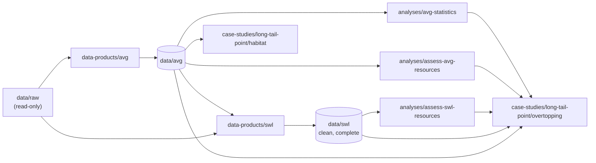

# great_lakes

Case-study tooling built on `hydropattern` for the Great Lakes Framework Study and the
Great Lakes Coastal Resiliency Study. It has three layers:

- **Data products** (`data-products/`): cleaning, scenario completion, figures and
  gates for the avg (average monthly lake level) and swl (storm water level) data.
- **Analyses** (`analyses/`): workflows that run on those data. Each has its own README.
- **Case studies** (`case-studies/`): worked examples using the tooling (Long Tail Point
  overtopping and habitat).

See [`GLOSSARY.md`](./GLOSSARY.md) for the domain vocabulary (**resource**, **resources
sheet**, **config sheet**, **subdirectory structure**) used throughout this document.

## How the pieces fit



avg and swl are separate datasets and are never mixed. Overtopping uses both; habitat uses
avg only. The two case studies share no drafts, memos or scripts. Planned analyses
(`report-resources`, `assess-avg-resource`, `assess-swl-resource`) are stubs. Every
`methods/` note is listed in [`docs/methods-index.md`](docs/methods-index.md); data folders
are described in [`data/README.md`](data/README.md).

## Directory layout

```
├── README.md                  <- this file
├── GLOSSARY.md                <- domain glossary
├── docs/
│   ├── data_pipelines.md         <- end-to-end run order, raw data to outputs
│   ├── methods-index.md          <- every methods/ note, with type and status
│   ├── plans/                    <- reorg_plan.md and the two LTP memo plans
│   └── adr/                      <- decisions already made
├── src/great_lakes/              <- library code (logic lives here; scripts stay thin)
│   ├── batch/                       <- avg.py, swl.py (per-row processing), runner.py (shared
│   │                                   run_batch loop), run_readme.py, assess.py,
│   │                                   template_avg.py, template_swl.py
│   ├── paths.py                     <- Layout: every data/, data-products/ and analyses/ location
│   ├── cleaning/                    <- avg.py, swl.py (data/raw/ -> data/avg, data/swl/clean)
│   ├── units.py                     <- m<->ft and IGLD85<->NAVD88 conversions (separate steps)
│   ├── lakes.py                     <- lake names, avg filenames, centroid save points
│   ├── ari.py                       <- ARI constants and formatting
│   ├── avg_ari.py                   <- avg ARI response surfaces (Poisson method)
│   ├── avg_figures.py               <- avg mean-level figures (all 5 lakes)
│   ├── avg_stats.py                 <- generic avg statistics (annual maxima, window shares, ...)
│   ├── swl_method_quality.py        <- swl~avg regression and leave-one-out checks
│   ├── avg_scenario_stats.py        <- scenario avg change, persistence, Poisson examples
│   ├── scenario_grid.py             <- shared scenario-grid helpers and drawing
│   ├── swl/                         <- sheets.py, naming.py, contours.py, complete.py (fill +
│   │                                   extrapolate), figures.py, gates.py, effects.py
│   ├── build_dashboard.py            <- builds a self-contained results dashboard (import-only)
│   ├── dashboard_package.py          <- zips the dashboard and the files it links
│   ├── overtopping.py                 <- overtopping-specific memo figures/tables (T1, F4, runup)
│   └── memo/                          <- to_docx.py (Markdown -> .docx), from_docx.py (.docx ->
│                                         Markdown), sync.py (draft vs recovered-draft diff)
├── data/                       <- tracked data (inputs to everything else); see data/README.md
│   ├── raw/                    <- source Excel workbooks (read-only, never edited)
│   ├── avg/                    <- cleaned avg csvs (5 lakes) + figures/<lake>.png
│   └── swl/
│       ├── clean/              <- 5 known scenarios per lake + figures/<lake>.png
│       └── complete/           <- all 17 scenarios per lake + figures/<lake>.png
├── data-products/              <- one folder per product; each has its own README
│   ├── avg/   {inputs, scripts, methods, outputs}
│   └── swl/   {inputs, scripts, methods, outputs}   <- outputs/ is gitignored
├── analyses/                   <- one folder per workflow; each has its own README
│   ├── avg-statistics/            <- avg ARI response surfaces
│   ├── assess-avg-resources/      <- batch resource assessment against avg (hydropattern)
│   ├── assess-swl-resources/      <- batch resource assessment against swl
│   ├── report-resources/          <- stub
│   ├── assess-avg-resource/       <- stub
│   └── assess-swl-resource/       <- stub
│       (each: {scripts, methods, inputs, outputs}; outputs/ is gitignored)
└── case-studies/
    └── long-tail-point/
        ├── overtopping/            <- {inputs, scripts, methods, outputs, deliverables}
        └── habitat/                <- {inputs, scripts, methods, outputs, deliverables}
```

`data-products/*/outputs/`, `analyses/*/outputs/` and `case-studies/*/*/outputs/` are
gitignored (regenerable), except the memo figures and `dashboard.html`/`manifest.js` of
the overtopping case study and the figures and reliability tables of the habitat case study.
Everything under `data/` is tracked, including the summary figures. Each README says how
to regenerate its outputs:

| Folder | README |
| --- | --- |
| avg data product | [`data-products/avg`](data-products/avg/README.md) |
| swl data product | [`data-products/swl`](data-products/swl/README.md) |
| avg statistics | [`analyses/avg-statistics`](analyses/avg-statistics/README.md) |
| assess avg resources | [`analyses/assess-avg-resources`](analyses/assess-avg-resources/README.md) |
| assess swl resources | [`analyses/assess-swl-resources`](analyses/assess-swl-resources/README.md) |
| Long Tail Point overtopping | [`case-studies/long-tail-point/overtopping`](case-studies/long-tail-point/overtopping/README.md) |
| Long Tail Point habitat | [`case-studies/long-tail-point/habitat`](case-studies/long-tail-point/habitat/README.md) |

## Installation

```powershell
uv sync --group test --group dev
```

`hydropattern` is a pinned git dependency (see `pyproject.toml`); `pandas`,
`openpyxl`, `scipy` (Delaunay triangulation, via `climate-canvas`), `python-calamine`
(fast `.xlsx` reading), and `xlsxwriter` (workbook writing) are all direct dependencies.

You only need to re-run the data-product scripts if the raw source workbooks in
`data/raw/` change (see each product's README for options such as `--units`/`--datum`):

```powershell
uv run python data-products/avg/scripts/clean.py --overwrite
uv run python data-products/avg/scripts/plot_figures.py
uv run python data-products/swl/scripts/clean.py --overwrite
uv run python data-products/swl/scripts/complete.py --overwrite
uv run python data-products/swl/scripts/plot_figures.py
```

## Analyses

After the data products are built (see each workflow README for options):

```powershell
uv run python analyses/avg-statistics/scripts/plot_ari_surfaces.py
uv run python analyses/assess-avg-resources/scripts/assess.py --resources my_run.xlsx
uv run python analyses/assess-swl-resources/scripts/assess.py --resources my_swl_run.xlsx
```

Without `--resources`, the assess scripts run the blank template in the workflow's
`inputs/templates/`. Copy the template to make your own worksheet; never edit it in place.

## Long Tail Point overtopping

After the data products above are built, run from the repository root:

```powershell
uv run python case-studies/long-tail-point/overtopping/scripts/make_figures.py
uv run python case-studies/long-tail-point/overtopping/scripts/run_assessments.py
uv run python case-studies/long-tail-point/overtopping/scripts/build_dashboard.py
uv run python case-studies/long-tail-point/overtopping/scripts/package_dashboard.py
```

`make_figures.py` regenerates F2-F4, T1-T2, the swl~avg regression and leave-one-out tables
in `outputs/figures/`; `run_assessments.py` runs the two resource worksheets;
`build_dashboard.py` and `package_dashboard.py` build the results dashboard and its zip. The
inputs are `data/avg/michiganhuron_avg.csv`, `data/swl/complete/michigan_swl.xlsx` and the
tracked worksheets in `inputs/`.

The memo is `deliverables/longtailpoint_memo_261030.docx`, edited by hand in Word (the final
text). `build_memo_docx.py` builds a docx from the Markdown draft into `outputs/`;
`sync_draft_from_docx.py` brings the draft back in line with the final docx. See the
[workflow README](case-studies/long-tail-point/overtopping/README.md).

## Long Tail Point habitat

Dead Horse Bay habitat resilience to the avg scenarios (avg only; no swl). From the
repository root:

```powershell
uv run python case-studies/long-tail-point/habitat/scripts/musky_runs.py
uv run python case-studies/long-tail-point/habitat/scripts/pondweed_runs.py
uv run python case-studies/long-tail-point/habitat/scripts/figure_lake_movement.py
```

The run scripts need `hydropattern` 0.3 or later; the figure scripts (F1, F3-F9) are
listed in the [workflow README](case-studies/long-tail-point/habitat/README.md), which also
covers the reliability tables, memo build and sync. The inputs are
`data/avg/michiganhuron_avg.csv` and the tracked files in `inputs/`; the memo is
`deliverables/LTP_habitat_resilience_memo-261112.docx`, edited by hand in Word.

